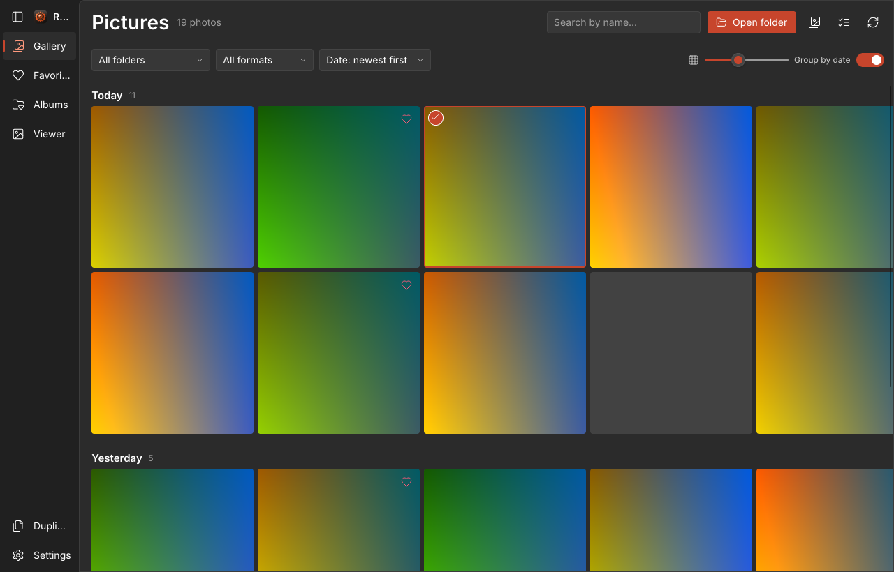
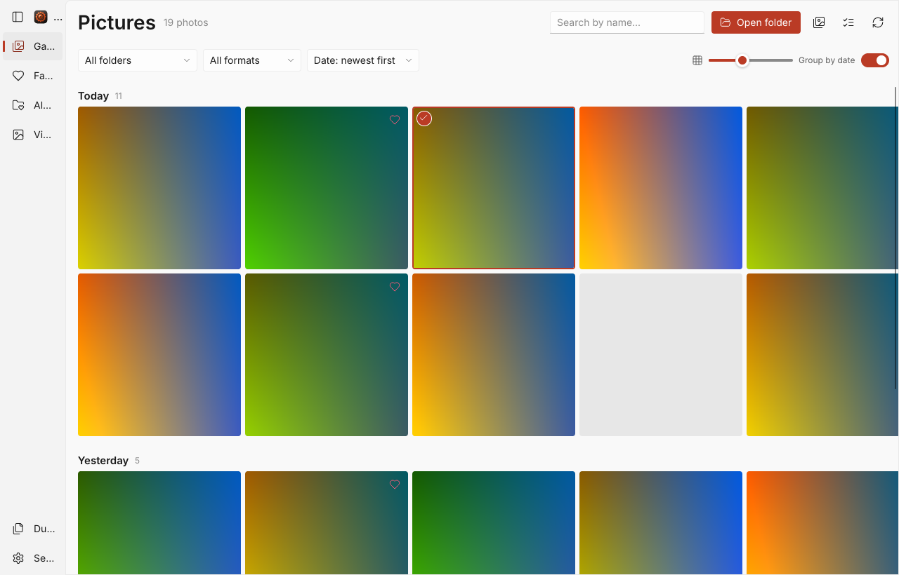
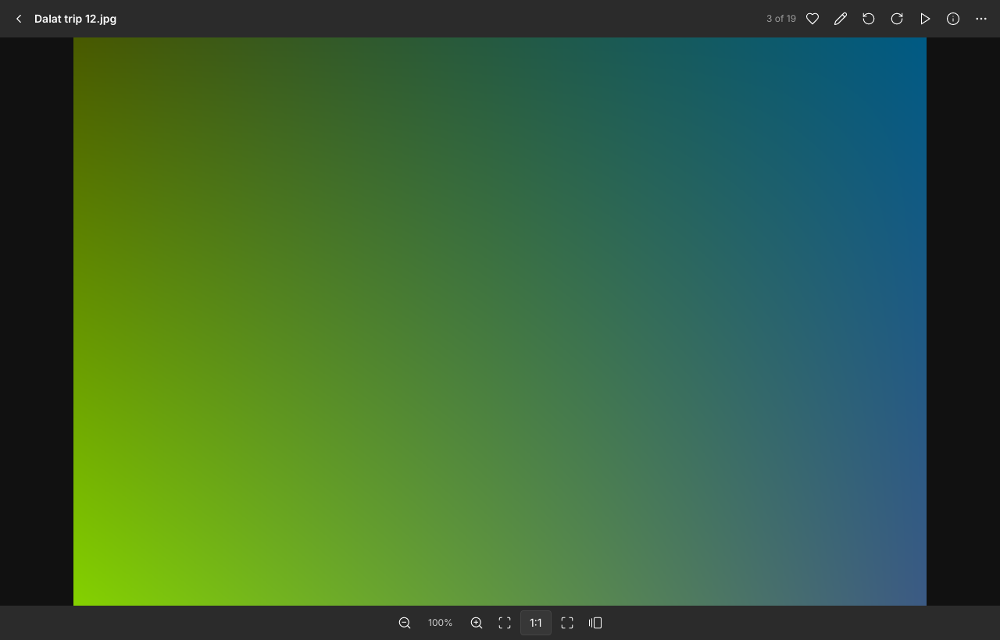
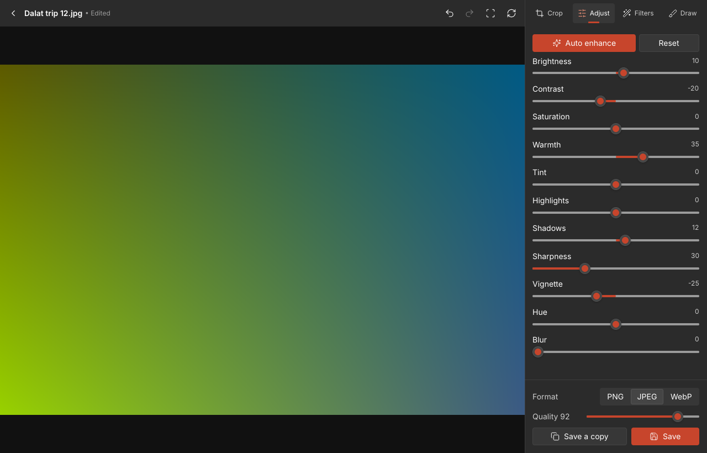
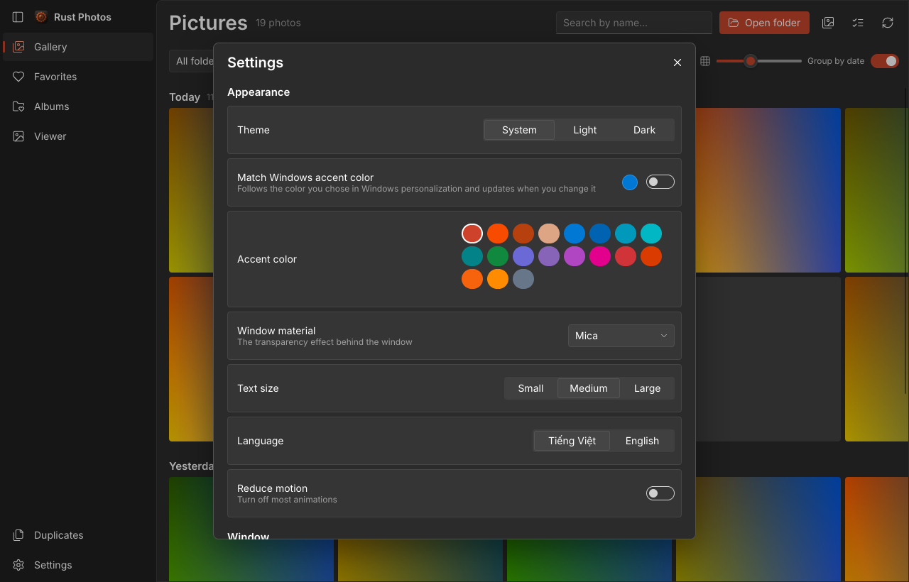

<div align="center">


# Rust Photos

**A fast, native photo viewer and editor for Windows — written in Rust, styled after WinUI 3 / Fluent Design.**
No WebView2. No JavaScript. One executable.


English · [Tiếng Việt](README.vi.md)

</div>

---

Rust Photos is a rewrite of a Tauri + React photo app as a single native Rust program. Everything that is not drawing —
folder scanning, thumbnails, EXIF, the editing pipeline, settings — lives in a pure Rust library, and the interface is drawn by
[Slint](https://slint.dev) with Fluent colours, spacing and controls. It browses a library, views pictures, edits them,
and stays out of your way.

## Screenshots

| | |
|---|---|
|  |  |
|  |  |
|  | |

*These are renders of the real interface with generated sample pictures.*

## Features

**Library**
- Scans a folder and its sub folders (up to 50 000 pictures), groups by day, six sort orders, filters by folder and format, search
- Thumbnail size slider, selection mode, drag & drop, "Open with" from Explorer, one window only
- Favourites, albums, duplicate finder (identical files), batch rename (`{n}`, `{name}`)
- The gallery refreshes itself when you come back to the window, and keeps your place when it does

**Viewer**
- Wheel zoom around the cursor, pan, fit / 1:1, next and previous picture are decoded in advance
- Optional thumbnail strip (button or `T`), slideshow (interval, shuffle, loop), full screen
- Details panel with EXIF, GPS and histogram
- Rotate, copy image or path, show in Explorer, print, set as wallpaper, rename, copy / move, delete to the Recycle Bin with **Undo**

**Editor**
- Crop with aspect ratios and rule-of-thirds guide, straighten, rotate, flip
- 11 adjustments (brightness, contrast, saturation, warmth, tint, highlights, shadows, sharpness, vignette, hue, blur) and auto enhance
- 12 filters with strength, hold-to-compare, 100 steps of undo / redo
- Pen, highlighter, line, arrow, rectangle, ellipse, text, pixelate and blur regions, with a layer list
- Save a copy or overwrite; PNG, JPEG (EXIF kept) and WebP

**Look and feel**
- WinUI 3 style: Fluent colour tokens, 4 px controls, content-dialog layout, light / dark / follow Windows
- Mica, Mica Alt and Acrylic backdrops on Windows 11
- **Accent colour follows Windows by default**, or choose one of 19 colours
- English and Vietnamese, three text sizes, reduce-motion option, remembers window size

## Installation

Rust Photos needs Windows 10 or 11 (64-bit). The Mica / Acrylic backdrops need Windows 11.

**From an installer** — build it yourself, see [Build](#build-and-package): `rust-photos_3.0.0_x64-setup.exe`. It installs for the current
user, needs no administrator rights, and the uninstaller can also remove the app data.

**Portable** — build `rust-photos.exe` and copy it anywhere. The C runtime is linked in, so no Visual C++ Redistributable is required.

Settings, favourites and albums are stored in `%APPDATA%\RustPhotos`, thumbnails in `%LOCALAPPDATA%\RustPhotos`.
If something goes wrong inside an image decoder, the error is written to `crash.log` next to the settings.

## Tech stack

| Area | Crates |
|---|---|
| UI | [Slint](https://slint.dev) 1.19 (winit window, femtovg OpenGL renderer, software fallback) |
| Window backdrop | window-vibrancy (Mica, Mica Alt, Acrylic) |
| Images | image, jpeg-decoder (decode JPEG at 1/2–1/8 size for thumbnails), fast_image_resize (SIMD), resvg (SVG) |
| Drawing on pictures | tiny-skia, ab_glyph, fontdb |
| Metadata | kamadak-exif |
| Concurrency, hashing | rayon, xxhash-rust |
| System | trash, rfd (dialogs), arboard (clipboard), single-instance, winreg, windows-sys, dirs, sys-locale |
| Data | serde, serde_json, chrono |
| Icons | [Lucide](https://lucide.dev) (ISC) |
| Packaging | [cargo-packager](https://github.com/crabnebula-dev/cargo-packager) → NSIS |

## Development

```powershell
cargo run -p rust-photos                      # debug build
cargo run --release -p rust-photos            # release build
cargo test -p rust-photos-core                # 16 tests: library, EXIF, thumbnails, editing pipeline, settings
cargo check --workspace --all-targets
```

Useful extras:

```powershell
$env:FP_STATS=1; cargo run --release -p rust-photos   # title bar shows Rust heap, thumbnails, viewer cache, startup times
cargo run -p rust-photos --example shot dark          # renders the interface to PNG files with the software renderer
cargo run -p rust-photos --example startbench         # times the gallery on a synthetic library (UI thread work)
cargo run -p rust-photos-core --example make_icon -- crates/app/ui/icon.svg crates/app/assets/icon.ico icon-512.png
```

`membench` (thumbnail memory, reads `/proc`) is Linux only.

## Build and package

```powershell
# release executable  ->  target\release\rust-photos.exe
cargo build --release

# installer  ->  target\release\rust-photos_3.0.0_x64-setup.exe
cargo install cargo-packager --locked         # once
cargo packager --release --formats nsis
```

`cargo packager` has no `init` step here: its settings are already in `crates/app/Cargo.toml` under `[package.metadata.packager]`
(name, identifier, icon, per-user NSIS installer). It does not compile the app itself, so the same table tells it to run
`cargo build --release -p rust-photos` first. The first run downloads the NSIS tools.

`.cargo/config.toml` links the C runtime statically on Windows. The release profile uses fat LTO and one codegen unit, so the first
release build is slow and the result is small and fast.

## Project structure

```
rust-photos/
├─ .cargo/config.toml          static C runtime on Windows
├─ Cargo.toml                  workspace and release profile
├─ screenshots/                image01.png … image05.png
└─ crates/
   ├─ core/                    pure Rust engine, no UI code
   │  ├─ i18n/                 en.json, vi.json
   │  ├─ src/                  library, thumbs, decode, exif_util, files, store, theme, i18n, edit/
   │  ├─ tests/core.rs
   │  └─ examples/             membench, make_icon
   └─ app/                     Slint interface and glue
      ├─ src/                  lib.rs, main.rs, state.rs, editor.rs, platform.rs, util.rs
      ├─ ui/                   *.slint, icon.svg, icons/ (Lucide)
      ├─ assets/               icon.ico, icon-512.png
      └─ examples/             shot, startbench
```

## Performance notes

Measured on Linux with 24 JPEGs of 12 MP, thumbnails with 8 workers: peak memory fell from 755 MB to 62 MB and speed doubled after
switching to scaled JPEG decoding. For 50 000 pictures the gallery re-cuts its rows in about 60 ms when the window is resized
(an unoptimised build; release is faster). These numbers cover the Rust side only: the graphics driver and system libraries add their own
memory, and real start-up time on Windows depends on the GPU and Mica. Run with `FP_STATS=1` to see the split on your PC.

## Known limitations

- Colour emoji stickers, AVIF pictures and slideshow transitions are not implemented yet
- WebP export is lossless only
- The installer is English only and not code-signed, so SmartScreen may warn about an unknown publisher
- Windows only; the Windows-specific parts (accent colour, Mica, wallpaper, print) were written without a Windows test machine in the loop

## Credits

<div align="center">

### Made by **minhtrong67** · built together with **Claude**

</div>

Thanks to the [Slint](https://slint.dev) team, the authors of [Lucide](https://lucide.dev), and the maintainers of the crates above.

## License

MIT, see [LICENSE](LICENSE). Slint is available under the GPLv3, a royalty-free license that asks for attribution (the About box provides it),
or a commercial license — check which one suits how you distribute the app. Lucide icons are ISC.
