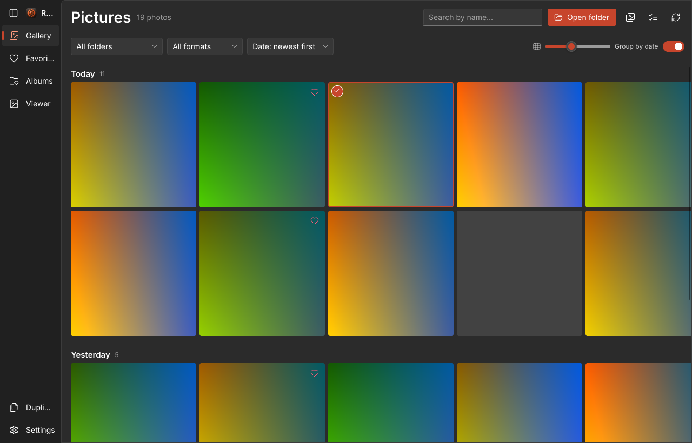
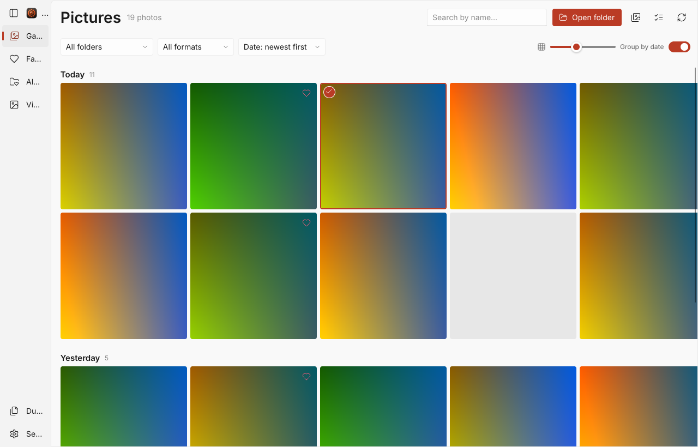
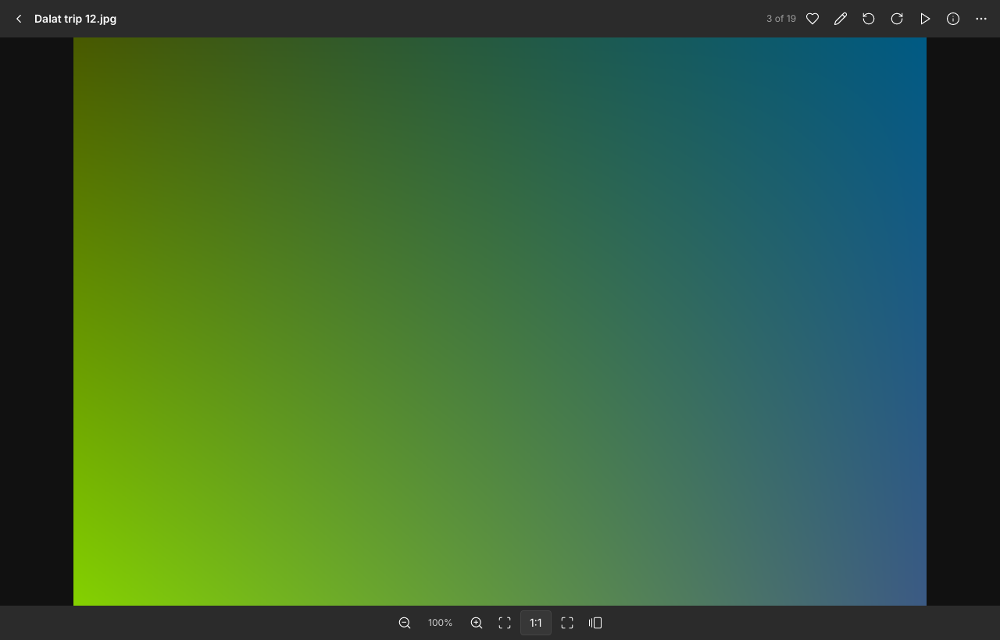
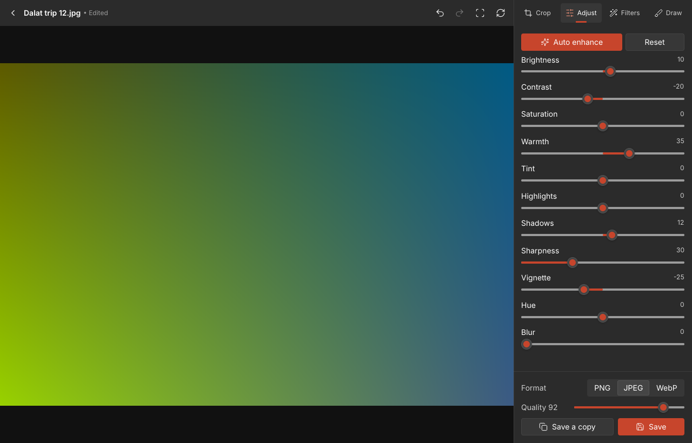
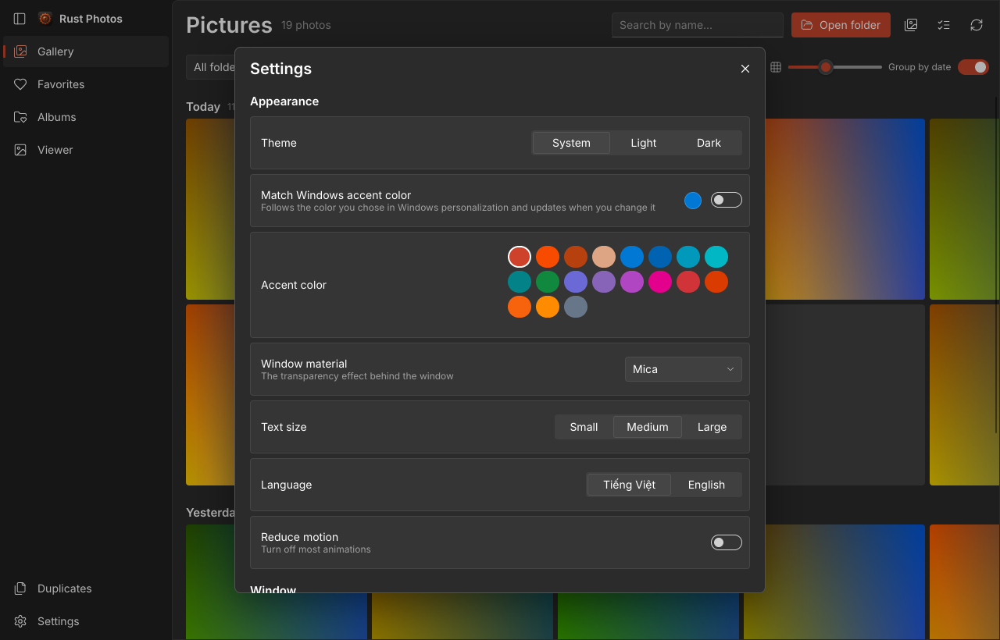

<div align="center">


# Rust Photos

**Trình xem và chỉnh sửa ảnh native cho Windows, viết bằng Rust, giao diện theo WinUI 3 / Fluent Design.**
Không WebView2. Không JavaScript. Chỉ một file chạy.


[English](README.md) · Tiếng Việt

</div>

---

Rust Photos là bản viết lại ứng dụng Tauri + React thành một chương trình Rust native duy nhất. Mọi việc không phải vẽ giao diện
(quét thư mục, thumbnail, EXIF, chỉnh sửa ảnh, cài đặt) nằm trong một thư viện Rust thuần, còn giao diện do
[Slint](https://slint.dev) vẽ với màu sắc, khoảng cách và control theo Fluent. Ứng dụng duyệt thư viện ảnh, xem ảnh, chỉnh sửa ảnh
và không làm phiền bạn.

## Ảnh chụp màn hình

| | |
|---|---|
|  |  |
|  |  |
|  | |

*Đây là ảnh dựng từ giao diện thật với ảnh mẫu được tạo ra.*

## Tính năng

**Thư viện**
- Quét thư mục và thư mục con (tối đa 50 000 ảnh), nhóm theo ngày, sáu kiểu sắp xếp, lọc theo thư mục và định dạng, tìm kiếm
- Thanh chỉnh cỡ ô ảnh, chế độ chọn nhiều, kéo thả, "Open with" từ Explorer, chỉ mở một cửa sổ
- Yêu thích, album, tìm ảnh trùng (file giống hệt), đổi tên hàng loạt (`{n}`, `{name}`)
- Thư viện tự làm mới khi bạn quay lại cửa sổ và giữ nguyên vị trí cuộn

**Trình xem**
- Zoom bằng con lăn quanh vị trí chuột, kéo ảnh, vừa khung / 1:1, ảnh kế tiếp và ảnh trước được giải mã sẵn
- Dải ảnh nhỏ tùy chọn (nút hoặc phím `T`), trình chiếu (thời gian, xáo trộn, lặp), toàn màn hình
- Bảng chi tiết có EXIF, GPS và biểu đồ histogram
- Xoay, sao chép ảnh hoặc đường dẫn, mở trong Explorer, in, đặt hình nền, đổi tên, sao chép / di chuyển, xóa vào Thùng rác kèm **Hoàn tác**

**Trình chỉnh sửa**
- Cắt theo tỉ lệ có lưới 1/3, chỉnh thẳng, xoay, lật
- 11 thông số (độ sáng, tương phản, bão hòa, ấm, sắc, vùng sáng, vùng tối, độ nét, vignette, màu, làm mờ) và tự động tăng cường
- 12 bộ lọc có độ mạnh, giữ để so sánh, hoàn tác / làm lại 100 bước
- Bút, bút dạ, đường thẳng, mũi tên, chữ nhật, elip, chữ, pixelate và làm mờ vùng, có danh sách lớp
- Lưu bản sao hoặc ghi đè; PNG, JPEG (giữ EXIF) và WebP

**Giao diện**
- Phong cách WinUI 3: màu theo Fluent, control bo 4 px, hộp thoại kiểu content dialog, sáng / tối / theo Windows
- Hiệu ứng nền Mica, Mica Alt và Acrylic trên Windows 11
- **Màu nhấn mặc định theo Windows**, hoặc chọn một trong 19 màu
- Tiếng Việt và tiếng Anh, ba cỡ chữ, tùy chọn giảm hiệu ứng, nhớ kích thước cửa sổ

## Cài đặt

Rust Photos cần Windows 10 hoặc 11 (64-bit). Hiệu ứng Mica / Acrylic cần Windows 11.

**Bằng bộ cài**: tự build theo mục [Build](#build-và-đóng-gói), ra file `rust-photos_3.0.0_x64-setup.exe`. Bộ cài cài cho người dùng hiện tại,
không cần quyền quản trị, và trình gỡ cài đặt có thể xóa luôn dữ liệu ứng dụng.

**Bản portable**: build `rust-photos.exe` rồi chép đi đâu cũng được. Thư viện C runtime đã nhúng sẵn nên không cần Visual C++ Redistributable.

Cài đặt, yêu thích và album lưu trong `%APPDATA%\RustPhotos`, thumbnail lưu trong `%LOCALAPPDATA%\RustPhotos`.
Nếu bộ giải mã ảnh gặp lỗi, lỗi được ghi vào `crash.log` cạnh file cài đặt.

## Công nghệ

| Mảng | Thư viện |
|---|---|
| Giao diện | [Slint](https://slint.dev) 1.19 (cửa sổ winit, bộ vẽ femtovg OpenGL, dự phòng software) |
| Nền cửa sổ | window-vibrancy (Mica, Mica Alt, Acrylic) |
| Ảnh | image, jpeg-decoder (giải mã JPEG ở 1/2–1/8 kích thước cho thumbnail), fast_image_resize (SIMD), resvg (SVG) |
| Vẽ lên ảnh | tiny-skia, ab_glyph, fontdb |
| Metadata | kamadak-exif |
| Song song, băm file | rayon, xxhash-rust |
| Hệ thống | trash, rfd (hộp thoại), arboard (clipboard), single-instance, winreg, windows-sys, dirs, sys-locale |
| Dữ liệu | serde, serde_json, chrono |
| Icon | [Lucide](https://lucide.dev) (ISC) |
| Đóng gói | [cargo-packager](https://github.com/crabnebula-dev/cargo-packager) → NSIS |

## Phát triển

```powershell
cargo run -p rust-photos                      # bản debug
cargo run --release -p rust-photos            # bản release
cargo test -p rust-photos-core                # 16 test: thư viện, EXIF, thumbnail, chỉnh sửa ảnh, cài đặt
cargo check --workspace --all-targets
```

Công cụ phụ:

```powershell
$env:FP_STATS=1; cargo run --release -p rust-photos   # thanh tiêu đề hiện heap Rust, số thumbnail, cache trình xem, thời gian khởi động
cargo run -p rust-photos --example shot dark          # dựng giao diện ra file PNG bằng software renderer
cargo run -p rust-photos --example startbench         # đo thư viện ảnh giả lập (phần việc trên luồng giao diện)
cargo run -p rust-photos-core --example make_icon -- crates/app/ui/icon.svg crates/app/assets/icon.ico icon-512.png
```

`membench` (đo bộ nhớ thumbnail, đọc `/proc`) chỉ chạy trên Linux.

## Build và đóng gói

```powershell
# file chạy release  ->  target\release\rust-photos.exe
cargo build --release

# bộ cài  ->  target\release\rust-photos_3.0.0_x64-setup.exe
cargo install cargo-packager --locked         # một lần
cargo packager --release --formats nsis
```

Ở đây không có bước `cargo packager init`: cấu hình đã nằm sẵn trong `crates/app/Cargo.toml` mục `[package.metadata.packager]`
(tên, identifier, icon, bộ cài NSIS cho người dùng hiện tại). `cargo-packager` không tự biên dịch ứng dụng, nên mục này cũng khai báo
chạy `cargo build --release -p rust-photos` trước. Lần chạy đầu sẽ tải công cụ NSIS.

`.cargo/config.toml` nhúng C runtime tĩnh trên Windows. Profile release dùng LTO đầy đủ và một codegen unit, nên lần build release đầu
chậm, đổi lại file nhỏ và nhanh.

## Cấu trúc dự án

```
rust-photos/
├─ .cargo/config.toml          C runtime tĩnh trên Windows
├─ Cargo.toml                  workspace và profile release
├─ screenshots/                image01.png … image05.png
└─ crates/
   ├─ core/                    engine Rust thuần, không có code giao diện
   │  ├─ i18n/                 en.json, vi.json
   │  ├─ src/                  library, thumbs, decode, exif_util, files, store, theme, i18n, edit/
   │  ├─ tests/core.rs
   │  └─ examples/             membench, make_icon
   └─ app/                     giao diện Slint và phần kết nối
      ├─ src/                  lib.rs, main.rs, state.rs, editor.rs, platform.rs, util.rs
      ├─ ui/                   *.slint, icon.svg, icons/ (Lucide)
      ├─ assets/               icon.ico, icon-512.png
      └─ examples/             shot, startbench
```

## Ghi chú hiệu năng

Đo trên Linux với 24 ảnh JPEG 12 MP, tạo thumbnail bằng 8 luồng: bộ nhớ đỉnh giảm từ 755 MB xuống 62 MB và tốc độ tăng gấp đôi sau khi
chuyển sang giải mã JPEG theo kích thước thu nhỏ. Với 50 000 ảnh, thư viện cắt lại các hàng trong khoảng 60 ms khi đổi kích thước cửa sổ
(bản chưa tối ưu, bản release nhanh hơn). Các số này chỉ tính phần Rust: driver đồ họa và thư viện hệ thống cộng thêm bộ nhớ riêng, còn thời gian
khởi động thật trên Windows phụ thuộc GPU và Mica. Chạy với `FP_STATS=1` để xem phần nào thuộc về ứng dụng trên máy bạn.

## Hạn chế hiện tại

- Chưa có sticker emoji màu, ảnh AVIF và hiệu ứng chuyển ảnh khi trình chiếu
- Xuất WebP chỉ ở chế độ lossless
- Bộ cài chỉ có tiếng Anh và chưa ký số, nên SmartScreen có thể cảnh báo nhà phát hành chưa xác định
- Chỉ chạy trên Windows; các phần riêng của Windows (màu nhấn, Mica, hình nền, in) được viết khi chưa có máy Windows để thử trong vòng lặp phát triển

## Tác giả

<div align="center">

### Thực hiện bởi **minhtrong67** · xây dựng cùng **Claude**

</div>

Cảm ơn đội ngũ [Slint](https://slint.dev), tác giả [Lucide](https://lucide.dev) và những người duy trì các thư viện kể trên.

## Giấy phép

MIT, xem [LICENSE](LICENSE). Slint có ba lựa chọn: GPLv3, giấy phép miễn phí yêu cầu ghi công (hộp About đã có), hoặc giấy phép thương mại;
hãy kiểm tra lựa chọn nào hợp với cách bạn phân phối ứng dụng. Icon Lucide theo giấy phép ISC.
